# Shade Protocol — Litepaper

**Private by default. Verifiable by design.**

*Version 0.1 (draft) · October 2026 · Status: devnet/testnet only, unaudited, experimental*

> **Read this first.** Shade Protocol is an early-stage, open-source research project. It runs on developer networks (devnets/testnets) only. The code has **not** been audited, its zero-knowledge proving keys come from a **development trusted setup that is not secure for real value**, and parts of the system (notably every chain adapter other than Solana) may still be in progress. There is no token, no mainnet deployment and no partnership with any chain, exchange or broker mentioned in this document. Nothing here is financial, legal or tax advice.

---

## 1. The problem: public ledgers leak too much

Public blockchains made something new possible: anyone can verify that every transfer and trade followed the rules, without trusting a bank or an exchange to keep honest books. The price of that verifiability is that **everything is visible to everyone, forever**.

In practice that means:

- **Balances are public.** Once someone links a wallet to you — through an exchange withdrawal, an ENS-style name, an NFT purchase or a single payment — they can see what you hold and everything you have ever done with it.
- **Orders are public before they execute.** A trade sent to a public mempool or on-chain order book reveals its size, direction and limit price while it is still pending. Searchers and block builders can see it and act first.
- **Front-running and MEV are the result.** "Maximal extractable value" (MEV) is the profit someone can take by reordering, inserting or censoring transactions. For ordinary users it shows up as sandwich attacks, worse fills and higher slippage. For larger traders it means they cannot move size without telegraphing it.
- **Counterparties and strategies leak.** Businesses paying suppliers, funds rebalancing, or DAOs paying contributors all expose commercially sensitive information that would be confidential in traditional finance.

The usual responses are unsatisfying. Centralised venues hide your order from the public but require you to trust the operator with both your data and your funds. Mixers break links but offer no structure for trading and no way to prove anything to an auditor afterwards. "Just use a fresh wallet" does not survive contact with real usage.

## 2. The idea in one paragraph

Shade Protocol is a **shielded execution layer**: users hold value as encrypted *notes* inside a shielded pool, move it with **zero-knowledge proofs** that show a transaction is valid without revealing who, what or how much, and trade through a **dark pool** where orders stay hidden until they are matched and settled. On top of that sits a **selective-disclosure toolkit** — optional KYC proofs, scoped viewing keys and a sanctions-screening hook — so that users and integrators who need to show information to an auditor or regulator can do so deliberately, rather than leaking it to the whole world by default. The core is chain-agnostic; thin adapters connect it to individual chains, starting with **Solana devnet**.

## 3. How it works, in plain language

### 3.1 Shielded notes

Think of a note as a sealed envelope with a value inside, written to a public noticeboard.

- **Depositing** ("shielding") moves tokens from a normal wallet into the pool. In return a new envelope — a *note* — is pinned to the board. Only a **commitment** to it is public: a fingerprint that hides the amount and owner but cannot later be changed.
- **Spending** a note means proving, in zero knowledge, three things at once: *"one of the envelopes on the board is mine"*, *"I haven't opened it before"*, and *"the value going out equals the value coming in"* — without saying which envelope.
- To stop double-spending, each spent note reveals a **nullifier**: a unique tag that only the owner can compute. The chain records it. If the same note is spent twice, the same nullifier appears twice and the second spend is rejected. Nobody can tell which commitment a nullifier belongs to.
- The **recipient** of a transfer receives fresh notes addressed to a one-time **stealth address**, with the note details encrypted so only they can read them. Observers cannot link payments to the recipient's public identity or to each other.

All commitments live in a **Merkle tree** — a compact structure that lets anyone check "this item is in the set" from a single short root hash. The chain stores the root; users prove membership against it.

### 3.2 The dark pool

The dark pool lets two users trade assets held as shielded notes without exposing their orders to the public mempool.

1. **Submit.** A trader locks an input note into an *order commitment* and submits it with a proof that they own sufficient funds. Order details (pair, side, size, limit price) are encrypted to the matching engine. The public only sees an opaque commitment.
2. **Match.** At the end of each batch window, the matching engine pairs buy orders with sell orders whose limit prices cross. Buys are only matched against sells, each order is filled at most once (or partially, with the remainder carried forward), and price-time priority decides who goes first.
3. **Settle.** Each match is settled on-chain by a transaction carrying a proof that both sides' input notes were valid and unspent, that both received the right outputs, and that no value was created or destroyed. Input nullifiers are published; new output notes are encrypted to each trader.

Because orders are not visible until after they are settled — and even then only as commitments and nullifiers — there is nothing public for a front-runner to act on.

**What you trust the matcher for (and what you don't).** In the current design the matching engine is operated by a known party and can read the orders it matches. It **cannot** steal funds or forge trades, because every settlement must pass the on-chain proof check. It **could** censor orders, or leak order information it sees. Reducing this trust — for example with threshold decryption, multi-party computation or trusted hardware — is on the roadmap, not in the current build.

### 3.3 Proofs

Validity is enforced by an arithmetic circuit (written in Circom) that checks Merkle membership, nullifier derivation, ownership, value conservation and range limits. Users generate a **Groth16** proof locally; the chain verifies it cheaply. Groth16 needs a one-off "trusted setup"; see §6.

## 4. Selective disclosure and compliance tooling

Privacy that can never be opened is hard to use for businesses, and privacy that is always open is not privacy. Shade's design goal is **privacy by default, disclosure by choice, and verifiability always**. It provides tools; whether a particular deployment meets any particular law is for its operator and their advisers to determine.

- **Zero-knowledge KYC credentials.** A KYC provider (an *issuer*) can sign a credential for a user after its own checks. The user can then prove statements such as "my credential is from an issuer this pool accepts, is not expired, has at least level 2, and my jurisdiction is in the allowed set" — without revealing their identity, the credential itself or their jurisdiction. Pools can require such a proof to deposit or trade.
- **Viewing keys.** Every user has a viewing key separate from their spending key. They can share it — whole, or scoped to a time window — with an accountant, auditor or regulator, who can then decrypt that user's notes but **cannot spend them**.
- **Auditor ciphertexts (optional, per pool).** A pool may be configured so that each note also carries a copy of its details encrypted to a designated auditor public key. This is a policy decision made visibly at pool creation, not a hidden backdoor, and pools without it remain fully private.
- **Sanctions-screening hook.** Deposits and withdrawals cross the boundary between public and shielded state. At that boundary an integrator can plug in a screening provider of their choice to check public addresses. Shade supplies the hook; it does not supply or endorse any list.

## 5. Multi-chain approach

The privacy logic — notes, commitments, nullifiers, the Merkle tree, proofs and matching — lives in a chain-agnostic core. Each chain gets a **thin adapter** that only verifies proofs, stores roots and nullifiers, and custodies pooled tokens using that chain's native tools.

| Chain | Adapter target | Status |
|---|---|---|
| Solana | On-chain program verifying Groth16 proofs via Solana's alt_bn128 syscalls | **First target — devnet** |
| NEAR | Smart contract using NEAR's alt_bn128 host functions | Testnet — in progress |
| Canton | Daml workflows for institutional settlement | Research / in progress |
| Robinhood | Adapter for Robinhood's chain environment *(see TODO in docs)* | Research / in progress |

Listing a chain here describes an engineering target only. **Shade Protocol has no partnership, endorsement or affiliation with Solana, NEAR, Canton/Digital Asset, Robinhood or any other organisation.** Cross-chain transfers between shielded pools are not part of the current scope.

```mermaid
flowchart LR
  subgraph Client["USER DEVICE"]
    SDK["Wallet + ShadeClient SDK"]
    K["Keys: spend / view"]
    P["Local prover<br/>Circom + Groth16"]
    SC["Note scanner"]
  end
  subgraph Core["SHADE CORE (chain-agnostic)"]
    N["Notes, commitments,<br/>nullifiers"]
    T["Poseidon Merkle tree"]
    M["Dark-pool matcher<br/>+ settlement"]
    C["Compliance tools<br/>KYC proofs · view keys · screening"]
  end
  subgraph Chains["THIN CHAIN ADAPTERS"]
    S["Solana — devnet"]
    NE["NEAR — in progress"]
    CA["Canton — in progress"]
    RH["Robinhood — in progress"]
  end
  Client == "proofs + ciphertexts" ==> Core
  Core == "verify · store roots & nullifiers" ==> Chains
```

## 6. Security model and trust assumptions

Shade is designed so that **funds safety depends on mathematics and on-chain verification, not on any operator**. Specifically, we assume:

1. **Cryptography holds.** Poseidon is collision-resistant, Groth16 on the BN254 curve is sound, ECDH on Baby Jubjub is hard to break, AES-256-GCM and HKDF-SHA256 are secure. BN254 offers roughly 100–128 bits of security by current estimates; this is standard for Ethereum-style zk systems but is not "post-quantum".
2. **The trusted setup was honest.** Groth16 proving keys come from a setup ceremony. If *every* participant kept their secret randomness, they could forge proofs and create value from nothing. Today's keys come from a **development setup with a single contributor — it must be assumed compromised and must never protect real value.** A public multi-party ceremony, where one honest participant suffices, is required before any mainnet.
3. **The circuit and contracts are correct.** A missing constraint is a critical bug. This is the main reason an independent audit is required.
4. **The chain is live and honest.** Shade inherits its host chain's liveness, censorship resistance and finality.
5. **The dark-pool matcher is trusted for order privacy and fairness, not for funds.** See §3.2.
6. **Users protect their keys.** Losing a spending key loses funds; leaking a viewing key leaks history.

Privacy is also statistical: the **anonymity set** is only as large as the number of real users and notes. A small devnet pool provides little practical privacy, and timing, amounts and deposit/withdrawal patterns can still link activity.

## 7. Status and roadmap

**Where we are now (October 2026).** The codebase is being rewritten from an early scaffold into the architecture described here: a real Poseidon Merkle tree, hiding and binding commitments, per-note nullifiers, ECDH stealth addresses with KDF-derived AES-GCM encryption, a Circom circuit enforcing membership, conservation and range checks, Groth16 proofs, fixed dark-pool matching and settlement, the compliance toolkit, CI, and a Solana devnet adapter first. Licence: MIT (pending). Nothing is on mainnet.

| Phase | Milestone | What it means |
|---|---|---|
| 0 | **Devnet** *(now)* | Solana devnet deployment, SDK, test suite and CI. Development trusted setup only. Expect breaking changes and resets. |
| 1 | **Testnets + hardening** | NEAR testnet and other adapters; fuzzing, internal review, public bug reports. |
| 2 | **Independent audit** | Third-party review of circuits, cryptography, contracts and SDK; findings published. |
| 3 | **Trusted setup ceremony** | Public multi-party ceremony for production Groth16 keys, with published transcripts. |
| 4 | **Mainnet (conditional)** | Only after phases 2–3, with conservative deposit limits and staged rollout. |

No dates are promised. Each phase begins only when the previous one is genuinely finished.

**Token.** *TODO (owner): Shade Protocol currently has no token. If that changes, a separate, reviewed document is needed. Until then, any token claiming to be "Shade Protocol" is not ours.*

## 8. Risks and disclaimers

- **Experimental software.** Shade Protocol is unaudited research code under active development. It may contain bugs that lead to total loss of funds or loss of privacy. Use only on devnets/testnets with valueless test tokens.
- **No financial, legal or tax advice.** Nothing in this document is an offer, solicitation or recommendation to buy, sell or hold any asset. There is no token, no yield and no expected return.
- **Not a compliance guarantee.** The selective-disclosure features are tools. Using them does not by itself make any deployment or user compliant with any law, and no regulator has reviewed or approved Shade Protocol.
- **Regulatory uncertainty.** Privacy technology is treated differently across jurisdictions and the rules are changing. Users and integrators are responsible for their own legal position.
- **Privacy is not absolute.** Small anonymity sets, metadata (IP addresses, timing, amounts) and user error can all reveal information.
- **Third-party dependencies.** Host chains, RPC providers, KYC issuers and screening providers are outside the project's control.
- **Forward-looking statements.** Roadmap items describe intentions, not commitments, and may change or never happen.

**Learn more:** technical documentation in [`docs/`](docs/architecture.md) · source at [github.com/Chenz0-13/shade-protocol](https://github.com/Chenz0-13/shade-protocol) · security reports: see [`docs/security.md`](docs/security.md).
