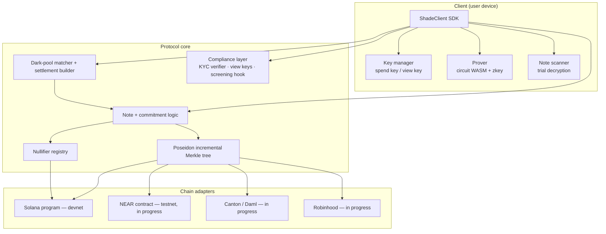
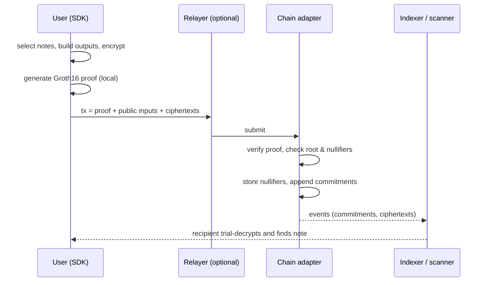

# Architecture

> **Status:** devnet/testnet only · unaudited · development trusted setup · API and parameters subject to change. This page describes the **target architecture** that the codebase is being rewritten towards. Where this page and the code disagree, the code in [the repository](https://github.com/Chenz0-13/shade-protocol) is authoritative — please open an issue.

## 1. Design goals

1. **Funds safety comes from proofs, not operators.** Any state change to the shielded pool must carry a valid zero-knowledge proof that the on-chain verifier accepts.
2. **Privacy by default, disclosure by choice.** Amounts, owners and order details are hidden unless a user (or an explicitly configured pool policy) discloses them.
3. **Chain-agnostic core, thin adapters.** Protocol logic is written once; adapters only translate it to chain-native verification, storage and custody.
4. **Policy separated from execution.** Compliance tooling sits at the boundary (deposit, withdraw, order admission) and never inside the core state-transition rules.
5. **Backend-agnostic proofs.** Groth16 is the first proving system; interfaces are designed so another backend (e.g. PLONK or Halo2) can be swapped in later.

## 2. Components



| Component | Responsibility | Trust |
|---|---|---|
| **ShadeClient SDK** | Key management, note scanning, proof generation, transaction building | Runs on the user's device; holds secrets |
| **Prover** | Generates Groth16 proofs from the Circom circuit (`.wasm` witness generator + `.zkey`) | Local; never sends private inputs anywhere |
| **Note scanner** | Watches new commitments/ciphertexts and trial-decrypts with the view key | Local |
| **Merkle tree** | Append-only Poseidon tree of note commitments; root history | Mirrored on-chain (roots) and off-chain (full tree, rebuildable from events) |
| **Nullifier registry** | Set of spent nullifiers; rejects duplicates | On-chain, authoritative |
| **Dark-pool matcher** | Decrypts admitted orders, matches crossing orders in batches, builds settlement witnesses | Trusted for order confidentiality, liveness and fairness — **not** for funds |
| **Compliance layer** | Verifies KYC proofs, manages viewing-key disclosure and optional auditor ciphertexts, calls screening hooks | Policy is per pool and public |
| **Chain adapter** | Verifies proofs, stores roots and nullifiers, custodies pooled tokens, emits events | Inherits the host chain's security |
| **Relayer** *(optional)* | Submits a user's transaction so the user's public wallet does not pay gas | Can censor, cannot steal (fee and recipient are bound into the proof) |

## 3. State

On-chain, per pool and per asset:

- `roots[]` — a ring buffer of the most recent Merkle roots (target: 100). Proofs may reference any root in the buffer, so a proof built a few blocks ago still verifies after new deposits.
- `nullifiers` — a set of spent nullifiers.
- `nextLeafIndex` — position for the next commitment.
- `vault` — the pooled tokens backing all notes.
- Events: `NoteCommitted(leafIndex, commitment, ciphertext, ephemeralPubKey, viewTag)`, `NullifierSpent(nullifier)`.

Off-chain, per user: spending key, viewing key, the list of owned notes (value, blinding, leaf index), and a local copy of the tree (or a trusted indexer's).

## 4. Transaction lifecycle

### Deposit (shield)
1. Client creates a note for its own shielded address and computes its commitment.
2. Optional: compliance layer checks the depositing public address (screening hook) and/or a KYC proof, as required by the pool policy.
3. Client generates a proof with `publicAmount = +v` and no real inputs.
4. Adapter verifies the proof, pulls `v` tokens from the depositor into the vault, appends the commitment and emits the ciphertext.

### Transfer (shielded → shielded)
1. Client selects up to two input notes, fetches Merkle paths against a recent root.
2. Builds up to two output notes (recipient + change), each encrypted to its owner via a stealth address.
3. Generates a proof that inputs exist and are owned, nullifiers are correct, outputs are well-formed and `Σin = Σout + fee`.
4. Adapter verifies the proof, checks the root is known and nullifiers are unused, records nullifiers, appends output commitments.

### Withdraw (unshield)
As a transfer, with `publicAmount = −v` and a public recipient address bound into the proof via `extDataHash`. Screening hook may apply to the recipient.

### Dark-pool trade
See [dark-pool.md](dark-pool.md).



## 5. Repository layout (target)

The codebase is being restructured; the layout below is indicative. *TODO (owner): confirm against the merged rewrite.*

```text
shade-protocol/
├── circuits/          # Circom sources, build scripts, dev trusted-setup scripts
├── src/core/          # crypto, Merkle tree, notes, nullifiers, dark pool, compliance
├── src/sdk/           # ShadeClient
├── chains/solana/     # Solana program + client adapter (devnet)
├── chains/near/       # NEAR contract (in progress)
├── chains/canton/     # Daml templates (in progress)
├── chains/robinhood/  # adapter (in progress)
├── tests/             # unit, circuit and integration tests
└── .github/workflows/ # CI
```

## 6. Chain adapter notes

- **Solana (devnet)** — first target; Groth16 verification via the alt_bn128 syscalls.
- **NEAR (testnet)** — in progress; verification via alt_bn128 host functions.
- **Canton** — in progress / research; Daml templates for settlement workflows. Proof verification is likely to sit with a participant node rather than on-ledger.
- **Robinhood** — in progress / research. *TODO (owner): state precisely what this adapter targets (e.g. Robinhood Chain testnet as an EVM environment, or a broker API) and keep the no-affiliation statement.*

Shade Protocol has no partnership, endorsement or affiliation with any of these networks or companies.

## 7. Non-goals (current scope)

- Cross-chain shielded transfers or bridging.
- A governance system or token.
- Hiding network-level metadata (use Tor/VPN and a relayer if this matters to you).
- Guaranteeing any regulatory status for any deployment.
