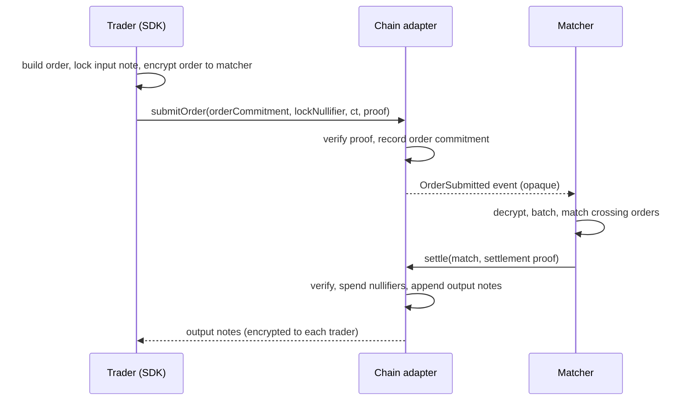

# Dark pool

> **Status:** devnet/testnet only · **unaudited** · matching engine operated by a single known party on devnet · parameters subject to change.

The dark pool lets holders of shielded notes trade with each other without exposing orders to the public mempool or an on-chain order book. It is designed to remove the public information that front-running and sandwich attacks rely on.

## 1. Order lifecycle

### 1.1 Order structure

An order opens to:

$$
\mathsf{order} = (\mathsf{pair},\ \mathsf{side} \in \{\text{buy},\text{sell}\},\ \mathsf{size},\ \mathsf{limitPrice},\ \mathsf{expiry},\ \mathsf{noteRef},\ \rho)
$$

where `noteRef` identifies the input note that funds the order and $\rho$ is a random order secret. On-chain the adapter stores only

$$
O = H(\mathsf{DOM}_{order},\ \mathsf{pair},\ \mathsf{side},\ \mathsf{size},\ \mathsf{limitPrice},\ \mathsf{expiry},\ C_{in},\ \rho)
$$

together with an AEAD ciphertext of the order encrypted to the matcher's public key (ECDH + HKDF + AES-256-GCM, as for notes).

### 1.2 Submission

The trader submits $O$, the ciphertext and a proof that:

- the funding note $C_{in}$ is in the commitment tree and owned by the trader;
- it holds at least the required amount of the correct asset (`size` of base for a sell; `size × limitPrice` of quote for a buy);
- $O$ is correctly formed.

The funding note is **locked**: its nullifier is not yet revealed, but the order commitment references it so the same note cannot back two live orders. *TODO (owner): confirm the locking mechanism used in code (e.g. "lock nullifier" $H(\mathsf{DOM}_{lock}, sk, C_{in})$ vs. moving funds into an escrow note).*

Optionally, pool policy may require a KYC proof at submission (see [compliance.md](compliance.md)).

### 1.3 Matching

The matcher runs in **discrete batches** (target: one batch every few seconds on devnet; configurable).

Rules (fixing bugs in the original scaffold, which matched any two overlapping orders regardless of side, could match one order many times, and produced no output notes):

1. Only **buy vs sell** on the **same pair** can match.
2. Orders cross if $\text{limit}_{buy} \ge \text{limit}_{sell}$.
3. **Price-time priority:** best price first; within a price level, earliest submission first.
4. **Execution price:** the midpoint of the two limits, $P = \lfloor(\text{limit}_{buy} + \text{limit}_{sell}) / 2\rfloor$, rounded to the pair's tick. *TODO (owner): confirm midpoint vs. maker-price vs. uniform batch clearing price in the final engine.*
5. **Each order is consumed at most once per batch.** A partial fill produces a remainder order (fresh commitment, same limit) that carries into the next batch.
6. Expired orders are dropped and their funding notes unlocked.

### 1.4 Settlement

Each match produces one settlement transaction carrying a Groth16 proof from the [settlement circuit](circuits.md#3-settlement-circuit-dark-pool). On success the adapter:

- spends both funding-note nullifiers;
- appends four output commitments — buyer's base, buyer's quote change, seller's quote, seller's base change — each encrypted to its owner's stealth address;
- emits a `Settled(matchId)` event with no amounts, prices or identities.

If settlement fails (e.g. a note was spent elsewhere), the match is discarded and the other side's order returns to the book.

### 1.5 Cancellation

A trader can cancel by proving knowledge of $\rho$ and ownership of $C_{in}$; the order commitment is marked cancelled and the funding note unlocked.

## 2. What is public

| Data | Visible to public | Visible to matcher | Visible to counterparty |
|---|---|---|---|
| That an order was submitted | Yes (opaque commitment, timestamp) | Yes | — |
| Pair, side, size, limit | No | **Yes** | No (only what they receive) |
| Trader identity / wallet | No (if submitted via relayer) | No | No |
| Execution price and fill size | No | Yes | Implied by their own output notes |
| That a settlement occurred | Yes | Yes | Yes |

The **aggregate** depth reported by the SDK (`getAnonymizedDepth`) is derived from the matcher's view and published only in coarse buckets, if at all. *TODO (owner): decide whether to publish any depth data.*

## 3. Trust model

| The matcher **cannot** | The matcher **can** |
|---|---|
| Steal funds or create value — every settlement needs a valid proof | See the contents of orders it receives |
| Settle a trade outside your limit price or above your size | Delay or refuse to match orders (censorship / liveness) |
| Spend your notes without a matching order | Choose between equally valid matches (fairness) |
| Link your order to your public wallet (if you use a relayer) | Leak order information it has seen |

So: **funds safety is cryptographic; order confidentiality and fair ordering are operator trust assumptions** in the current design.

### Roadmap to reduce matcher trust (research, not implemented)

- Threshold decryption of orders across several independent matchers after a batch closes.
- Matching inside MPC or a TEE, with remote attestation.
- Public, verifiable batch-clearing rules so that unfair ordering is detectable.

## 4. MEV considerations

- Orders are not visible in the public mempool; a searcher sees an opaque commitment.
- Settlement transactions reveal no price or size, so there is nothing to sandwich.
- Remaining leakage: the timing and count of orders and settlements, and the moment a trader deposits into or withdraws from the shielded pool. Users who care should deposit well in advance and withdraw with a delay.
